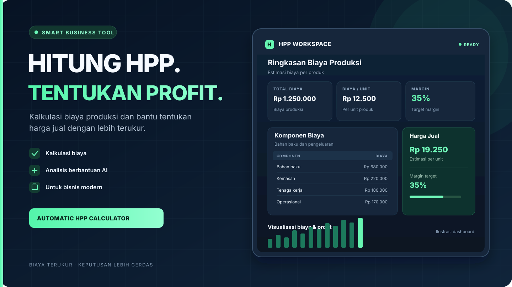

# Automatic HPP Calculator

<p align="center">
  <strong>Calculate production costs. Price with confidence.</strong><br>
  A practical cost-of-goods-sold calculator for small businesses, makers, and entrepreneurs.
</p>

<p align="center">
  <a href="https://vercel.com/dzakiudins-projects/v0-automatic-hpp-calculator">
    
  </a>
  <a href="https://github.com/Dzakiudin/Automatic-HPP-Calculator">
    
  </a>
  
</p>

<p align="center">
  
</p>

---

## Overview

**Automatic HPP Calculator** helps business owners estimate *Harga Pokok Produksi/Penjualan (HPP)*, organize production costs, and make more informed pricing decisions. It combines cost-calculation workflows with optional AI-assisted suggestions to make product costing easier to manage.

> AI-generated recommendations are estimates to support decision-making, not a substitute for checking actual supplier prices and business expenses.

## Key Features

- **Production cost calculation** — organize cost components used to estimate product costs.
- **AI-assisted recommendations** — use Google Gemini for suggestions related to costs, selling prices, and product bundles.
- **Derived-product workflow** — support scenarios involving processed or secondary products and shared production costs.
- **Flexible cost inputs** — work with material, fixed, variable, and processing-cost data where applicable.
- **Web and mobile foundation** — built with Next.js and Capacitor, with an Android project included in the repository.
- **Configurable AI access** — provide a Gemini API key through the application's settings interface.

## Application Preview

<p align="center">
  
</p>

<p align="center">
  
  
  
  
</p>

## Technology Stack

| Area | Technology |
| --- | --- |
| Framework | [Next.js](https://nextjs.org/) |
| UI | [React](https://react.dev/), [Tailwind CSS](https://tailwindcss.com/), [shadcn/ui](https://ui.shadcn.com/) |
| AI integration | [Google Gemini API](https://ai.google.dev/) |
| Mobile runtime | [Capacitor](https://capacitorjs.com/) |
| Language | TypeScript |
| Deployment | [Vercel](https://vercel.com/) |

## Run Locally

### Prerequisites

- Node.js compatible with the version required by the installed Next.js release
- npm (included with Node.js)
- A Google Gemini API key for AI-assisted features

### Installation

1. Clone the repository and open its directory:

   ```bash
   git clone https://github.com/Dzakiudin/Automatic-HPP-Calculator.git
   cd Automatic-HPP-Calculator
   ```

2. Install dependencies:

   ```bash
   npm install
   ```

3. Start the development server:

   ```bash
   npm run dev
   ```

4. Visit [http://localhost:3000](http://localhost:3000).

The core application can be explored locally. AI-assisted features require a valid Gemini API key.

### Configure the Gemini API Key

Open the application's settings interface and enter your own Gemini API key. The current client implementation stores a user-provided key in the browser's `localStorage`.

**Security note:** this is a client-side integration. A key entered into the browser is available to that browser session and may be accessible to client-side code. Do not commit API keys to the repository or expose a private production key through a `NEXT_PUBLIC_` environment variable. For a public deployment, consider proxying Gemini requests through a server-side endpoint with appropriate authentication, rate limits, and usage controls.

## Build for Production

Build the application:

```bash
npm run build
npm run start
```

## Android Build

The repository includes an `android/` project configured with Capacitor. After installing dependencies, sync the web assets and open the native project:

```bash
npx cap sync android
npx cap open android
```

Use Android Studio to configure the signing settings and generate an APK or Android App Bundle (AAB). Native builds may require additional Android SDK and environment setup.

## Contributing

Suggestions, bug reports, and improvements are welcome. Open an issue to discuss a proposed change, or submit a pull request with a clear summary of the update.

## Project Links

- **Repository:** [Dzakiudin/Automatic-HPP-Calculator](https://github.com/Dzakiudin/Automatic-HPP-Calculator)
- **Deployment project:** [Vercel](https://vercel.com/dzakiudins-projects/v0-automatic-hpp-calculator)
- **Original UI workflow:** [v0 project](https://v0.app/chat/sSdTh694sId)
- **Promotional banner source:** [docs/hpp-calculator-banner.svg](docs/hpp-calculator-banner.svg)

---

<p align="center">
  Built to make product costing and pricing decisions easier.
</p>
